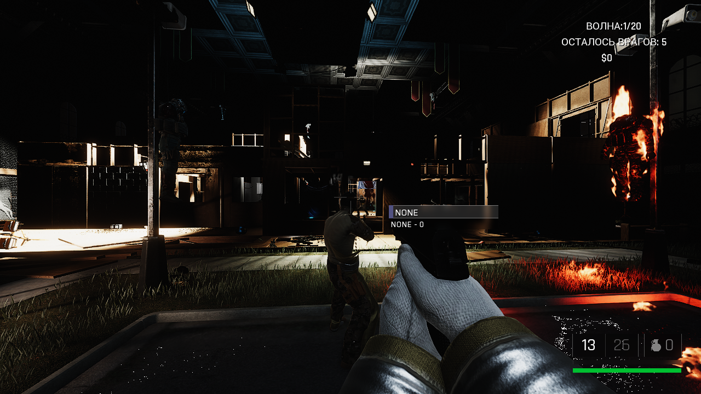

# Trepang2 Co-op

**English** · [Русский](dist_src/README.ru.md)

An unofficial mod that adds **co-op** to **Trepang2**: **Horde (Survival)** mode and, since v0.6, the **story campaign** (early).
Built on Unreal Engine's own networking plus the [UE4SS](https://github.com/UE4SS-RE/RE-UE4SS) mod loader.

> The mod was made with AI (Claude) to the player's design. It is not affiliated with Trepang Studios /
> Team17. No game files are stored or distributed here.

**Current version: v0.9.23 (alpha)** — download it from [Releases](../../releases).
Notes for every version are in [docs/releases](docs/releases).

## Install (both players)
1. Close the game, unpack the release zip, run `install.bat` (finds Trepang2 through Steam).
2. Start the game once; if the mod says "restart the game once" — restart it.

## Play
Everything is in one menu: press **F4** (main menu or in a level).
HOST, NEXT ARENA (Horde), JOIN (type the address), LEAVE, players, network mode (IP / Steam),
Steam invite, ENEMY HEALTH (tougher enemies for more players), and LOOK - your look for the others (safehouse outfit or any of 300 enemy variants
in 30 factions) with a turning preview of it.

Over the internet the host needs **UDP port 7777** open, or both players use Porthole / Radmin VPN / ZeroTier.

**Steam mode (experimental):** switch it in the F4 menu (both players, then restart the game). The host's
SteamID64 is shown in the menu; the friend types it as the join address. No port forwarding needed.
Easier: the host presses **INVITE (STEAM)** in the F4 menu and picks the friend in the Steam overlay;
the friend accepts the invite (or clicks "Join game" on the host in the Steam friends list, or the
host's name under "Steam friends hosting" in the F4 menu) and joins automatically.
Not yet tested between two different Steam accounts.

## Campaign (early, v0.6)
Side missions work the same way. Play the campaign as usual; in the safehouse or in a mission the host presses **F4 → HOST** (the level
reloads from the last checkpoint with the server on) and the friend joins. Wherever the host's game goes
(mission start, next level, checkpoint, restart) friends follow automatically. Story triggers are shared,
enemy squads come from the host, everyone down = back to the last checkpoint. Since v0.7 cutscenes play for
everyone at the same time (and wait until every player has come to where they start - "waiting for players k/n"), radio/dialogue lines with subtitles are heard by all, and doors the host's story
unlocks are unlocked for everyone. Since v0.7.4 anything used with the interact key (terminals, buttons,
levers, elevators, scripted scenes like the cultists' heavy doors) is shared - a partner pressing F moves
the story for everyone - and story objective markers show for every player.

## Features
- Each player plays their own full character; enemies, waves and money run on the host.
- Shots, damage (incl. headshots) and enemy deaths synced both ways; enemies hurt both players.
- Horde HUD for the partner; down & revive instead of death; auto-reconnect after an arena restart.
- Partners can use the Horde shop (shared money); partner picks up dropped / bought weapons; partner kills earn Horde money; partner markers; 3+ players.
- Partners' reload, weapon melee strike, grenade throw and weapon switch are shown on their body.
- Tougher enemies for more players: +0..200% health per extra player (F4 menu - ENEMY HEALTH, default +50%).
- Boss health bars for every player.
- While down you watch through your partner's eyes (left click - your own view).
- Missions finished, HVTs killed, weapon customizations and dual wield count in every player's own unlocks.
- When the level moves the host far away (Backrooms, scene cuts), partners are brought along automatically.
- F4 player list shows each player's health (or DOWN) and ping.
- Flashlights (T) are seen by everyone; slow-mo (Q) - the host's or a partner's - slows time for all players; invisibility (E) hides you from everyone and from the enemies.
- Partner markers show their health ("Name 60%") or DOWN.
- Stuck or fell through the map? F4 - TO THE HOST puts you next to the host.
- Ping (X): a marker with your name where you look, for everyone.
- Human shields: a partner can grab an enemy (hold it, let it go, throw it) and everyone sees it.
- Partner fire (incendiary rounds, molotovs) burns the real enemies; burning enemies burn for everyone.
- Every side mission and all 47 Horde arenas checked with a partner; partners get back in on their own after an arena change.
- Steam mode works (it used to ask for a restart forever); better sync over VPN / the internet (higher network speed).
- F4 menu in three short tabs: CO-OP, LOOK, EXTRAS.
- Enemy looks that froze the game (28 of 328) are left out; the F4 LOOK preview no longer crashes co-op games.
- EXTRAS (optional, each player sets their own, off = the game as it is): health regen up to 50/75/100%, max armor 100/200/300, auto resupply (ammo, grenade, focus every 60/30 s), resupply on kill, heal on execution, keep your weapon mods on guns you pick up, remember cheats between game launches, randomizer (weapon mods and colours).
- F6 quick access: weapon mods anywhere; in the safehouse missions, outfit, combat simulator, cheats; in Horde the shop.

## Known issues
See [docs/releases](docs/releases). Campaign co-op is early: bosses and some special scenes are not synced yet.

## For developers
`mod/T2Coop/Scripts/main.lua` is the whole mod. `MODLOG.md` documents every engine finding,
`PLAN.md` the roadmap, `tools/` the two-instance test setup.
